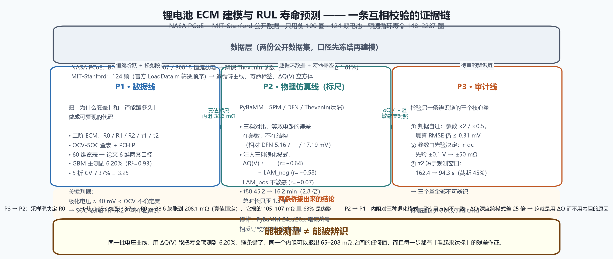

# How I built it：从一条电压曲线里，把「能测的」和「能辨识的」分开

> **English summary:** I built a three-layer evidence chain on two public battery datasets (NASA PCoE, MIT–Stanford). Layer 1 identifies a Thevenin equivalent-circuit model on NASA cells (median **1.61%** voltage-retest RMSE) and predicts cycle life from the first 100 cycles on 124 MIT cells (**6.20%** median error, R²=0.93). Layer 2 uses PyBaMM to inject known degradation modes, attributing ΔQ(V) to lithium inventory loss (r=+0.64) and negative-electrode active-material loss (r=+0.58). Layer 3 audits an independent ECM-identification pipeline and shows its three core quantities are **structurally unidentifiable** — using the simulation's ground truth as a ruler, **63%** of its reported ohmic resistance is an 18.7 s sampling artifact. The chain's conclusion is one sentence: **measurable ≠ identifiable**.



## 这个项目做了什么

从公开的电池充放电数据出发，回答两个问题：**电池为什么变差**，以及**还能跑多久**。但项目真正的内容是第三条线——用物理仿真当标尺，去检验一条别人写的辨识链到底站不站得住。

| 关键结果 | 数字 |
|---|---|
| ECM 参数辨识（NASA 4 颗，同工况复测） | RMSE 中位 **1.61%**（0.96 / 1.49 / 1.72 / 3.29 %） |
| 早期寿命预测（MIT 124 颗，前 100 圈） | 中位相对误差 **6.20%**（GBM，R²=0.93） |
| 跨批次泛化（60 维 → 论文 6 维） | 16.37% → **8.03%**（特征口径决定上限） |
| 全量 5 折交叉验证 | 7.37% ± 3.25（RF） |
| ΔQ(V) 机制归因（PyBaMM 注入） | 锂库存损失 **r=+0.64**、负极活性损失 **+0.58**、正极活性损失 −0.07 |
| 第三方辨识审计 | R0 中 **63%** 是采样伪影；τ2 短于观测窗口；r_dc 由先验决定 |

## 用到的工具

Python 3.13 · scipy / scikit-learn · pandas · h5py（MATLAB v7.3）· PyBaMM 26.x（DFN / SPM / Thevenin）· pytest · GitHub Actions CI · matplotlib

## 构建全过程（9 步）

### 第 0 步：先定口径，再写代码

数据口径比模型结构更能决定结论的上限。所以我第一件事不是建模，而是把两件事钉死：124 颗电池怎么筛（完整复刻官方 `LoadData.m` 的处理顺序），以及 ΔQ(V) 用哪个定义。后来证明，**60 维特征在测试集上很漂亮（6.20%）、换一批就翻车（16.37%）**，根子就在口径里混进了编码充电协议的滞回特征。

### 第 1 步：把端电压拆开（NASA）

在 NASA 四颗电池上辨识二阶 Thevenin 模型：松弛段双指数拟合 → OCV-SOC 查表 → 最小二乘定 R0/R1/R2。同工况复测 RMSE 中位 1.61%。这一步同时交出了后面整个项目都在用的**关键判据**——NASA 是恒流放电而非 HPPC 脉冲，一次阶跃下极化电压只有约 40 mV，**小于 OCV 的估计不确定度**，所以 R1/C1、R2/C2 的 SOC 依赖在这份数据上不可单独辨识。这不是模型缺陷，是数据决定的。

### 第 2 步：换观测量，而不是换模型（MIT）

预测寿命不看电压绝对值，看**同一圈充放电容量的差** ΔQ(V)。124 颗电池只用前 100 圈，GBM 把循环寿命（148–2237 圈）预测到 6.20% 中位误差。随后的消融给出一个可复用的结论：**同分布下 60 维有收益，跨批次只剩论文 6 维站得住**（8.58% → 8.03%）。小样本下树模型比深度模型稳——同一条 1D CNN，41 颗训练 32.7%、99 颗训练 12.1%，瓶颈是电池数不是结构。

### 第 3 步：建一把能给出真值的标尺（PyBaMM）

到这里两条线都只是"数据做得好"，还回答不了"为什么"。于是引入 PyBaMM：SPM / DFN / Thevenin(反演) 三档对比，相对 DFN 的 RMSE 5.16 / — / 17.19 mV——**等效电路的误差在参数，不在结构**。再往模型里注入三种已知退化模式（锂库存损失 / 正极活性损失 / 负极活性损失），看谁能产生与实测同形的 ΔQ(V)：实测形态与 LLI（r=+0.64）、LAM_neg（r=+0.58）同向，与 LAM_pos（r=−0.07）无关。**ΔQ(V) 主要测前两者。**

### 第 4 步：踩到一个会静默毁掉全部结论的坑

重跑快充协议时发现：1C 与 3C 的「充到 80% 时长」算出来**完全是同一个数**（45.0 min），物理上不可能。根因是 PyBaMM 的版本断裂——**24.x 放电电流取负，26.x 取正**；旧代码用电流符号判断充放电，在 26.10.1.0 下把充放电对调了，而且不报错。修复方式是从符号约定里解耦：改用**电压走向**判断（放电必降压、充电必升压、恒压段归充电）。这类 bug 的危险在于它不崩，只是安静地把结论颠倒过来。

### 第 5 步：顺出来两个负结果，都如实留下

- **仿真特征没能提升 RUL**：把 PyBaMM 分解出的退化模式系数作为新特征加进模型，四组对照全部持平或变差（8.33→8.41、6.31→6.69、8.58→9.63、8.03→8.31）。机制解释与统计预测是两件事。
- **协议没能拉开寿命**：七条快充协议中位误差离散度只有 0.05，比实测的 2.61 小两个数量级。原因有二：所有协议最终都要把同样的电量充进去；电压上限把激进协议的恒流段截断——`1C(80%)-3C(20%)` 里的 3C 段**一步也没走成**，整条协议退化为 1C 恒流（容量衰减 3.7666% vs 3.7666%，逐位相同）。**名义协议与实际执行轨迹可以是两件完全不同的事。**

### 第 6 步：审计另一条辨识链

一份独立完成的 ECM 辨识报「自报复算 RMSE ≤ 8.7 mV，达标」。我把它的链条拆开，做三组扰动：

1. **判据是自证的**——它的 OCV 是从同一套参数反推的，再仿真回去残差只剩离散化误差。把电阻全部翻倍或减半，RMSE 仍是 0.06–0.31 mV；只有「拿错电池」才掉到 8.7–12.0 mV。
2. **参数由先验决定**——直流内阻的公式里直接写着文献先验 OCV(0.5)=3.86 V。先验动 1 mV，r_dc 动 0.5 mΩ（它自述 ±25 mΩ，低估 4 倍）。三颗电池在任何先验下曲线完全重合——报「三颗一致」不是辨识结论，是同一个先验被复读了三次。
3. **τ2 短于观测窗口**——B0006 的松弛窗只有 77.7 s，却报 τ2 = 95.0 s；把 B0005 的窗口砍到 45%，τ2 从 162.4 掉到 94.3 s。

### 第 7 步：用仿真给出量级

第 6 步说明参数不可辨识，这一步给出差多少。把那条辨识流程**原样**套到 PyBaMM 的合成放电曲线上，只改采样间隔：R0 从 38.6 mΩ 膨胀到 **208.1 mΩ**（真值恒定），R1/R2 变成负数，而 r_dc 一动不动（被先验锚定）。而它报的阶跃内阻 105–107 mΩ，与 18.7 s 采样下的 105.0 mΩ **几乎逐位重合**——**它测到的 63% 是采样伪影**。这个实验只有物理仿真能做，因为它是一把给出真值的尺子。

### 第 8 步：同一次对照，回答了自己项目里的问题

为什么全部特征都建在 ΔQ(V) 上，而不建在更"物理"的内阻上？同一套参数集上注入三种退化模式，同时看两个观测量：内阻变化全在 ±7% 以内，**方向还互相矛盾**（LLI 让它降、LAM_neg 让它升）；ΔQ(V) 深度跨模式差 25 倍，且随退化单调放大。拿内阻当特征，等于用一个分不出退化模式的量去区分退化模式。这不是口味问题，是被仿真证明的。

### 第 9 步：工程化

9 个合成数据单元测试（ECM 在无噪声曲线上精确恢复已知参数、ΔQ 两种口径的量纲与端点、报告指标的同口径定义），接进 CI 与 `make test`——**clone 即可验证核心算法，不必先下载 8.6 GB 数据**。20 条踩坑记录全部留档，包括上面那个版本断裂。

## 你也可以跑一遍

```bash
pip install -r requirements.txt
python -m pytest tests/ -q        # 2 秒，合成数据，不需要原始数据集
# 完整复现：按 data/README.md 下载 NASA / MIT 数据后：
make all                          # 或逐步 make data / ecm / rul
python scripts/phase_d1_pybamm_sim.py   # 物理仿真
python scripts/phase_e_p3_audit.py      # 辨识审计
```

## 最大的三个坑（省流版）

1. **升级依赖会静默颠倒结论**：PyBaMM 24.x 与 26.x 的电流符号相反，用符号判充放电的代码在新版下不报错、只是把结果对调。凡是语义依赖库的约定，就写成与版本无关的形式（我用电压走向）。
2. **自证式判据等于没有判据**：如果验证用的量是从待验证参数反推的，那么任何参数都能通过。判据必须留独立验证集（另一圈、另一个 SOC、另一个倍率）。
3. **采样率会伪装成物理参数**：粗采样下的「阶跃内阻」里有 63% 是伪影。报参数时必须同时报采样条件，否则数字不可比。

## 学到的三件事

- **口径决定上限**：同一个模型，特征口径收一下，跨批次误差从 16.37% 掉到 8.03%。模型结构的影响远小于口径；
- **负结果是资产不是耻辱**：仿真增强无效、协议没拉开寿命，两条都写进了 README 与 CHANGELOG。它们比一个凑出来的「提升 6%」更能说明方法的边界；
- **能被测量不等于能被辨识**：同一批电压曲线，用 ΔQ(V) 能把寿命预测到 6.20%；用「先验锚定 + 自证判据 + 粗采样」的链条，同一个内阻可以报出 65–208 mΩ 之间的任何值，而且每一步都有「看起来达标」的残差作证。

## 资源

- 论文：Severson et al., *"Data-driven prediction of battery cycle life before capacity degradation"*, Nature Energy 2019, DOI [10.1038/s41560-019-0352-4](https://doi.org/10.1038/s41560-019-0352-4)
- 数据集下载与放置：[data/README.md](data/README.md)
- 完整推导（辨识审计）：[docs/audit.md](docs/audit.md)
- 与另一份独立复现的分工和口径对照：[docs/sibling_projects.md](docs/sibling_projects.md)
- 工作记录与 20 条踩坑：[docs/worklog.md](docs/worklog.md)
