<div align="center">

# Battery ECM Identification & Early Cycle-Life Prediction

**What you can measure is not what you can identify — a three-stage, reproducible study on public battery data**

[](https://github.com/ilo-love7/battery-ecm-rul/actions/workflows/ci.yml)
[](https://www.python.org/)
[](https://scikit-learn.org/)
[](LICENSE)
[](data/README.md)

<p align="center">
  <b>English</b> · <a href="./README.zh-CN.md">简体中文</a>
</p>

</div>

---

Using the public NASA PCoE and MIT-Stanford datasets, this repository turns "why a battery degrades" and "how much longer it will last" into reproducible code.

**One project, three stages**: P1 ECM identification and RUL prediction (reproduction) · P2 PyBaMM physical simulation (reproduction + original work) · P3 audit of a third-party identification chain (the link that joins the first two).

## Results at a glance

| Task | Metric | Result | Reference |
|---|---|---|---|
| ECM parameter identification | Same-condition re-test voltage RMSE (4 NASA cells) | **1.61%** (median)<br>0.96 / 1.49 / 1.72 / 3.29 % | measured range 2% |
| Early cycle-life prediction | Main test set, 43 cells, median relative error | **6.20%** (GBM, R² = 0.93) | Severson 2019: 9.1% |
| Cross-batch generalisation | Secondary test set, 40 cells (batch3), median relative error | **8.03%** (paper's 6 features, GBM) | same config on main test: 8.58% |
| Full cross-validation | 124 cells, 5-fold CV, median relative error | **7.37% ± 3.25** (RF) | — |
| Physical-simulation attribution | correlation of ΔQ(V) shape with MIT measurements | **+0.64** (lithium inventory loss)<br>+0.58 (negative-electrode active-material loss) | see [docs/sim.md](docs/sim.md) |
| Third-party identification audit | share of sampling artefact in the R0 that P3 reports | **63%** (ground truth 38.6 mΩ, reported 105–107 mΩ) | see [docs/audit.md](docs/audit.md) |

Only the **first 100 cycles** of each cell are used, to predict the cycle at which it reaches 80% capacity (148–2237 cycles, median 736.5).

> The first row uses the same official split as the paper, but a different feature and model configuration (this project: 60 dimensions + GBM; paper: 6 features + ElasticNet), so it is a magnitude reference only. The strict same-configuration comparison is the feature-ablation section below.

---

## How to read this project

The three pieces of work on the candidate list (P1 ECM/RUL, P2 physical simulation, P3 third-party identification) were originally pursued separately. This repository pulls them into **three stages of one project**, each supplying a layer of evidence:

| Stage | What it does | Key output | Docs |
|---|---|---|---|
| **P1** | Identify Thevenin parameters on NASA; predict cycle life from the first 100 cycles on MIT | re-test RMSE 1.61%; RUL median error 6.20% | [docs/method.md](docs/method.md) · [docs/results.md](docs/results.md) |
| **P2** | Build DFN/SPM/Thevenin in PyBaMM; inject known degradation modes | ΔQ(V) attributed to LLI + LAM_neg (r 0.64 / 0.58); internal-resistance ground truth 38.6 mΩ | [docs/sim.md](docs/sim.md) |
| **P3** | Audit the third-party identification chain, using P2 as the ground-truth ruler | criterion proves itself; parameters set by the prior; τ2 unidentifiable | [docs/audit.md](docs/audit.md) |

The conclusion that merges the three stages: **being measurable is not the same as being identifiable.**

## How the three lines connect

<table>
<tr>
<td width="50%">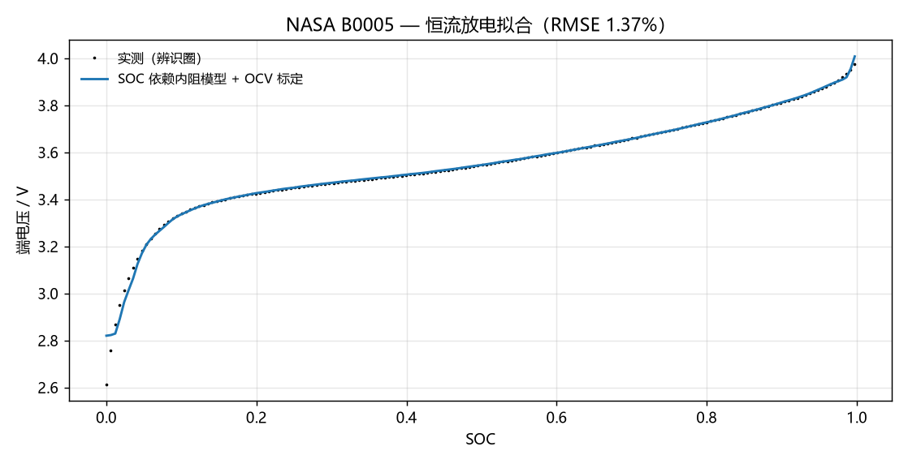</td>
<td width="50%">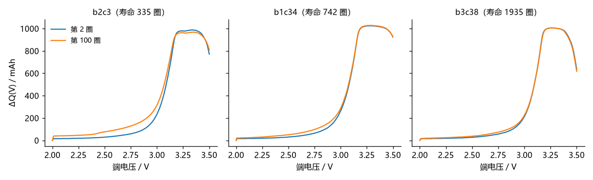</td>
</tr>
<tr>
<td align="center"><b>Line 1 · ECM</b>: a Thevenin equivalent circuit fitted to constant-current discharge curves,<br>yielding physically interpretable parameters OCV(SOC), R0, R_dc(SOC)</td>
<td align="center"><b>Line 2 · RUL</b>: the overall shift of the ΔQ(V) curve<br>is the most sensitive early aging signal</td>
</tr>
</table>

The first two lines share the same per-cycle data: ECM explains *why* a cell degrades, RUL answers *how much longer* it will last. The third line (PyBaMM simulation) connects them — an electrochemical model with explicit mechanisms shows **what ΔQ(V) actually measures**; see [section 3](#3-physical-simulation-pybamm).

The fourth line ([section 4](#4-auditing-a-third-party-ecm-identification-p3)) is a reverse test: take an independently produced P3 ECM identification, audit it, and use the internal-resistance ground truth from line 3 as the ruler. The conclusion is that **the parameters P3 reports are not identifiable**, which in turn explains why lines 1 and 2 must be separated — **being measurable is not the same as being identifiable.**

---

## 1. ECM parameter identification (NASA PCoE)

**Model**: first-order Thevenin RC

$$V_t = \mathrm{OCV}(\mathrm{SOC}) - I\,R_0 - I\,R_1\left(1 - e^{-t/\tau_1}\right)$$

**Identification procedure**

1. **OCV(SOC)** — average charge and discharge voltages over the first 20 cycles, binned by SOC (cancels polarisation hysteresis), then smooth with monotone PCHIP interpolation.
2. **OCV offset calibration** — fit a cubic polynomial δ(SOC) to the training-cycle residuals, removing the systematic low-SOC bias of the charge/discharge averaging.
3. **R0** — ΔV/ΔI at the discharge current step (0 → 2 A), on a millisecond scale, essentially uncontaminated by OCV error.
4. **R_dc(SOC)** — compute (OCV − V)/I per SOC bin in the constant-current region; subtract R0 to get the polarisation component R_pol.
5. **Validation** — identify on the 1st discharge, re-test under the same condition on the 3rd, compute the voltage RMSE.

**Results**

| Cell | R0 (mΩ) | R_dc(50%) (mΩ) | R_pol(50%) (mΩ) | Re-test RMSE |
|---|---|---|---|---|
| B0005 | 107.35 | 128.50 | 21.15 | 1.72% |
| B0006 | 105.92 | 130.45 | 24.54 | **0.96%** |
| B0007 | 107.58 | 128.27 | 20.68 | 3.29% ⚠️ |
| B0018 | 105.05 | 135.68 | 30.63 | 1.49% |

> ⚠️ **B0007 misses the target (3.29%)**: this cell shows pronounced capacity regeneration in its first 20 cycles, which contaminates the OCV estimate. That is a property of the data, and it is not hidden.

**A transferable conclusion**: as SOH falls from 100% to 70%, total DC internal resistance rises by about **33%** while the ohmic component rises only **5%** — aging mainly degrades the polarisation process, not the ohmic impedance.

**Identifiability boundary**: NASA data is constant-current discharge (not HPPC pulses). A single current step produces only about 40 mV of polarisation voltage, below the OCV estimation uncertainty, so the SOC dependence of R1/C1 and R2/C2 is **not separately identifiable**. A second-order fit drives R2 into its parameter bound — that is what the data supports, not a model defect.

---

## 2. Early cycle-life prediction (MIT-Stanford)

**Task**: input the ΔQ(V) curve over the first 100 cycles plus per-cycle scalars; output the cycle life (to 80% capacity).

**Features (two conventions)**

| Group | Content | Dimensions |
|---|---|---|
| Paper ΔQ(V) | `xq_log_var` / `xq_log_min` / `xq_log_mean` (log statistics of Q₁₀₀ − Q₁₀) | 3 |
| Hysteresis statistics | min, var, log\|min\|, mean for cycle 2 / cycle 100 / their difference | 12 |
| Hysteresis fixed points | capacity difference at 3.0 / 3.2 / 3.4 / 3.5 V | 12 |
| Aging scalars | capacity, internal resistance, charge time (first/last value, ratio, slope, intercept), temperature, coulombic efficiency | 18 |
| Charging policy | 15-dimensional fast-charge protocol parameters | 15 |

`feature_sets()` provides both the `full` (60-dimension) and `paper6` (the paper's 6 features) column sets for ablation.

**Main-protocol results** (strict official split: 41 train / 43 main test / 40 secondary test, 60-dimension features)

| Model | Main-test median error | Mean error | RMSE (cycles) | R² | Secondary-test median error |
|---|---|---|---|---|---|
| **GradientBoosting** | **6.20%** | 12.87% | **105.1** | **0.93** | 16.37% |
| ElasticNet (same as the paper) | 7.77% | 21.27% | 369.7 | 0.11 | 28.64% |
| MLP | 7.69% | 26.01% | 378.7 | 0.06 | 24.71% |
| RandomForest | 8.12% | 16.22% | 158.9 | 0.84 | **11.89%** |
| 1D CNN | 32.67% | 38.95% | 527.4 | −0.82 | 57.09% |
| Constant median (baseline) | 17.14% | 29.54% | 431.6 | −0.22 | 45.33% |

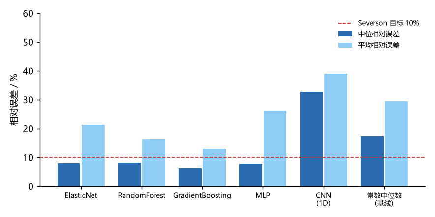

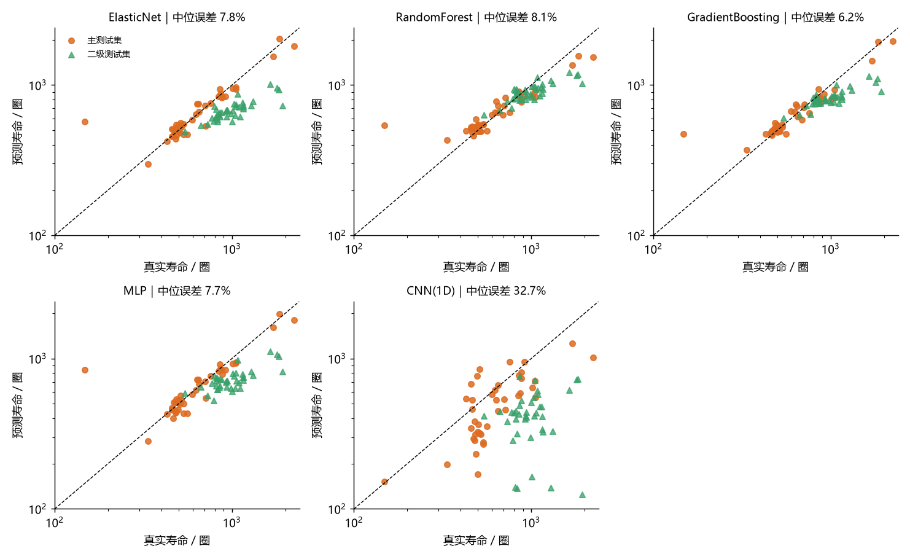

> **A note on statistics** ([docs/results.md](docs/results.md) 2.6): at n = 43, most of the gaps among the top four models are not statistically significant — the paired Wilcoxon test for GBM 6.20% vs EN 7.77% gives p = 0.93, and the bootstrap 95% CI is 5–9 percentage points wide. The ranking is descriptive. Only three statements are inferential: RandomForest is significantly worse than GBM (p = 0.006), the 1D CNN fails catastrophically (p = 1.8e-07), and RF is significantly better than GBM on the secondary test set (p = 0.0012).

**Feature-convention ablation: 6 vs 60 dimensions**

Same split, same models, only the feature set changes:

| Model | Main test (60-dim) | Main test (6-dim) | batch3 (60-dim) | batch3 (6-dim) |
|---|---|---|---|---|
| ElasticNet | 7.77% | 8.33% | 28.64% | **6.31%** |
| GradientBoosting | **6.20%** | 8.58% | 16.37% | **8.03%** |
| RandomForest | 8.12% | 9.38% | 11.89% | **8.22%** |

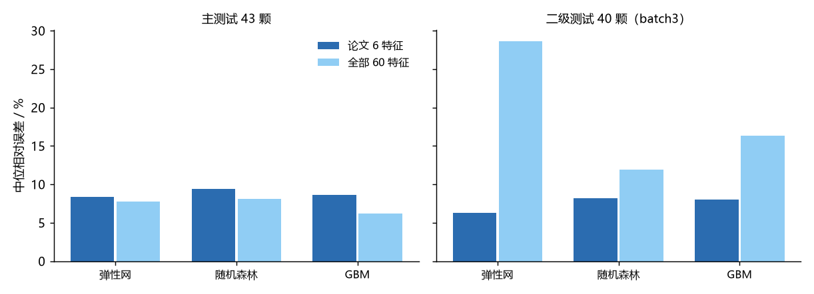

**Three takeaways**

1. **The feature convention decides cross-batch generalisation.** The 60 dimensions include hysteresis features that encode the charging protocol: 6.20% in-distribution looks great, 16.37% across batches gives it away. Switch to the paper's 6 dimensions and 8.58% → 8.03%, barely degrading; ElasticNet improves from 28.64% to 6.31% (**4.5×**). More dimensions is not better — what matters is whether the dimensions encode "the environment" rather than just "the battery".
2. **Tree models are the most stable at small sample sizes.** GBM gets 6.20% on the main test (R² = 0.93) and RF gets 11.89% across batches; each holds one end. ElasticNet has an R² of only 0.11 on 60 dimensions — a good median with enormous variance, unsuitable for delivery.
3. **Deep models need "number of cells", not "number of cycles".** The same 1D CNN goes from 32.7% with 41 training cells to 12.1% with 99 (5-fold CV). Each cell contributes only 100 cycle points, so what the model must learn is the variation *between* cells — 41 is not enough to estimate a convolutional network's parameters.

**Supplementary protocol**: 5-fold cross-validation over all 124 cells (grouped by cell, no cycle-level leakage)

| Model | Median error (mean ± std) |
|---|---|
| RandomForest | **7.37% ± 3.25** |
| GradientBoosting | 7.46% ± 1.66 |
| ElasticNet | 7.86% ± 0.99 |
| MLP | 9.56% ± 1.08 |
| 1D CNN | 12.11% ± 1.50 |

---

## 3. Physical simulation (PyBaMM)

The first two sections are data-driven: ECM parameters are fitted, ΔQ(V) features are statistical. This section supplies the *why*, using [PyBaMM](https://pybamm.org). Full method and limitations in [docs/sim.md](docs/sim.md).

**① Model hierarchy: the error comes from parameters, not structure**

1C constant-current discharge, with DFN as the reference:

| Model | Voltage RMSE vs DFN | Single solve |
|---|---|---|
| DFN (full order, electrolyte transport + particle diffusion) | 0 (reference) | 0.42 s |
| SPM (single particle) | **5.2 mV** | 0.17 s |
| Thevenin (parameters inverted from SPM) | 17.2 mV | 0.02 s |
| Thevenin (parameters identified in stage A) | **201.0 mV** | 0.02 s |

**Structural reduction costs only 5–17 mV; parameter mismatch costs 200 mV.** The R0 = 107 mΩ identified from NASA B0005 in stage A is an aged value, while a fresh Prada2013 cell is about 30 mΩ — the ECM is not wrong, the parameters simply cannot be carried across battery states.

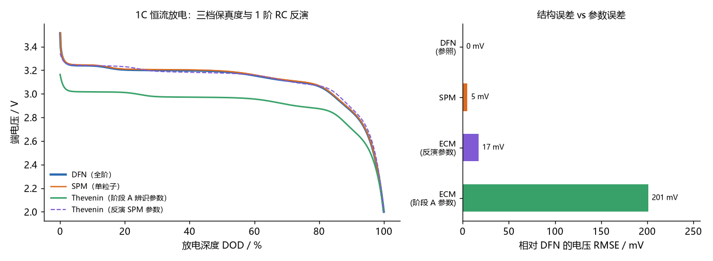

**② Fast charging: t80 can be cut 2.8×, total duration only 1.5×**

Simulation of seven multi-step constant-current protocols: 1C gives t80 = **45.2 min** and total duration 85.4 min; a 4.8C multi-step brings t80 down to **16.2 min** (−64%) while total duration only falls to 56.8 min (−34%) — the difference is entirely the constant-voltage stage. So "plug-in to unplug" duration is a poor fast-charge metric, and Severson's use of t80 is justified.

Temperature rise goes from 8.4 K to 29.9 K (`sev_4_8` is the highest). There is a by-product finding too: putting the 3C segment after 80% SOC (`1C(80%)-3C(20%)`) means the terminal voltage sits at 4.2 V immediately, so that constant-current segment **never executes a single step** and the whole protocol degenerates to 1C constant current — the two protocols' capacity fade, temperature rise and t80 agree bit for bit.

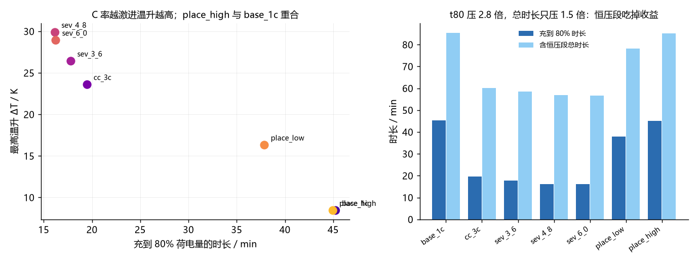

**③ What ΔQ(V) actually measures**

Inject three degradation modes into the LFP parameter set, see how ΔQ(V) is deformed, and compare against the MIT measurements:

| Degradation mode | Correlation with measured shape |
|---|---|
| Lithium inventory loss (LLI) | **r = +0.64** |
| Negative-electrode active-material loss (LAM_neg) | **r = +0.58** |
| Positive-electrode active-material loss (LAM_pos) | r = −0.07 |

**The measured ΔQ(V) is dominated by lithium inventory loss plus negative-electrode active-material loss; the positive electrode barely participates** — exactly the chemistry of an LFP cell. ΔQ(V) predicts cycle life because it encodes both *how much is lost* and *where it is lost*.

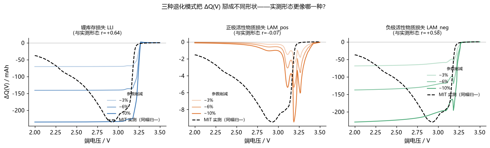

**④ An honest negative result**

Feeding the three simulated mode coefficients back into the prediction model as features gives **no improvement at all**:

| Feature set | Main test, 43 cells | batch3, 40 cells |
|---|---|---|
| P1 baseline (paper's 6 features, EN) | 8.33% | **6.31%** |
| P1 + simulated mode coefficients (EN) | 8.41% | 6.69% |
| P1 baseline (GBM) | 8.58% | 8.03% |
| P1 + simulated mode coefficients (GBM) | 9.63% | 8.31% |

The reason is that the mode coefficients barely vary across the 124 cells (the standard deviation of the LLI share is only 0.018), and the correlation between the simulated basis and the measured shape is only 0.64 — **physical interpretability is not statistical validity**. Under this project's acceptance criterion (≥5% improvement) this item fails, and it is recorded as such.

> **In one sentence**: the simulation explains why ΔQ(V) works, but it cannot replace it.

---

## 4. Auditing a third-party ECM identification (P3)

Item 3 on the candidate list (P3) is an ECM parameter identification completed **independently by another AI**. It delivers a complete identification chain: two-exponential fit of the relaxation segment → prior-anchored OCV to fix r_dc → amplitude-ratio decomposition of R0:R1:R2 → OCV back-solved → simulation re-computed. The re-computed RMSE is ≤ 8.7 mV, which looks like it passes the "≤2% of range" acceptance bar.

This project does not redo it; it takes the chain apart and tests each link. **The conclusion is that all three of its core quantities are unidentifiable.** Full derivation in [docs/audit.md](docs/audit.md).

**① The criterion proves itself: double the parameters, the residual stays put**

P3's OCV is back-solved from the parameters (`OCV := V_meas + I·ΣRᵢ(1−e^(−t/τᵢ))`) and then re-simulated with the same set, so the residual contains only discretisation error:

| Parameter set | B0005 | B0006 | B0007 |
|---|---|---|---|
| P3's original parameters | 0.12 mV | 0.16 mV | 0.15 mV |
| Parameters ×2 | 0.24 mV | 0.31 mV | 0.31 mV |
| Parameters ×0.5 | 0.06 mV | 0.08 mV | 0.08 mV |
| Another cell's model substituted | 9.63 mV | 8.68 mV | 11.96 mV |

Whether the internal resistance is doubled or halved, the RMSE stays within 0.31 mV. **The criterion places no constraint on the parameters at all.**

**② The parameters are decided by the prior**

`r_dc_mid = (OCV50_prior − V(SOC=0.5)) / I`. Sweeping the prior from 3.76 to 3.96 V (±0.1 V) moves r_dc for the three cells from 115.5/116.6/116.0 all the way to 214.8/215.9/216.6 mΩ — **a 1 mV prior shift moves r_dc by 0.5 mΩ**. P3's self-reported uncertainty of ±25 mΩ underestimates this by 4×. And the three cells' curves coincide under any prior, so its claim that "the three cells' r_dc agree" is not an identification result — it is the same prior read out three times.

**③ τ2 is a function of the window**

B0006's relaxation window is only 77.7 s, yet it reports τ2 = 95.0 s — a time constant longer than the observation window. Cut B0005's window to 45% and τ2 drops from 162.4 s to 94.3 s.

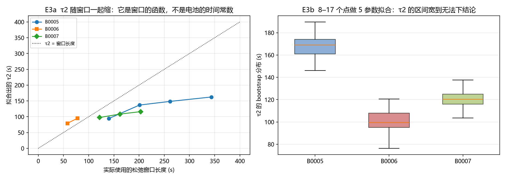

**④ The sampling rate decides R0: P2 as the ruler**

Apply P3's procedure unchanged to a PyBaMM DFN synthetic curve, changing only the sampling interval:

| dt | R0 / mΩ | R1+R2 / mΩ | first-point drop / I |
|---|---|---|---|
| 0.05 s | **38.6** (ground truth) | −3.7 | 38.6 |
| 2 s | 74.1 | −39.3 | 71.2 |
| 18.7 s (NASA's actual interval) | **208.1** | −173.6 | 105.0 |

The coarser the sampling, the more R0 inflates (5.4×) and the more R1/R2 go negative. The "step internal resistance" P3 reports, 105.9–107.5 mΩ, coincides almost bit for bit with the synthetic curve's 105.0 mΩ at dt = 18.7 s — **63% of what it measured is sampling artefact**.

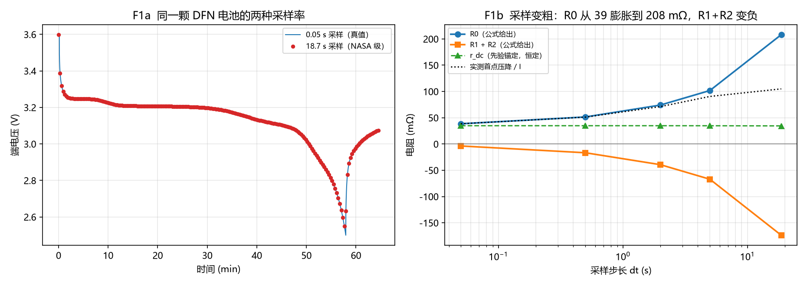

**⑤ Conversely, this explains why P1 does not use internal resistance**

| Degradation mode | R0 change (3%→10%) | ΔQ depth (3%→10%) |
|---|---|---|
| Lithium inventory loss (LLI) | 37.6 → 35.8 mΩ (−7.1%) | 70.6 → 235.2 mAh |
| Positive-electrode active-material loss (LAM_pos) | 38.7 → 38.9 mΩ (+0.8%) | 2.6 → 9.5 mAh |
| Negative-electrode active-material loss (LAM_neg) | 39.3 → 41.0 mΩ (+6.2%) | 68.8 → 229.4 mAh |

Internal resistance is nearly insensitive to all three degradation modes, and in inconsistent directions; ΔQ(V) differs across modes by a factor of 25. **That is the physical reason P1 builds every feature on ΔQ(V).**

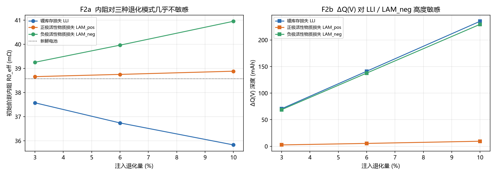

> **The three lines in one sentence**: P1 predicts cycle life from ΔQ(V); P2 shows that ΔQ(V) encodes LLI + LAM_neg and supplies the internal-resistance ground truth; P3's identification chain structurally cannot produce that ground truth. **Being measurable is not the same as being identifiable.**

---

## 5. Data convention: where 124 cells come from

Not every cell in the three MIT-Stanford batches qualifies under the paper's convention. This project **does not hard-code cell IDs**; it replicates the official `LoadData.m` processing order exactly (see [`reference/LoadData.m`](reference/LoadData.m)):

| batch | Processing | Kept |
|---|---|---|
| batch1 | 46 cells; splice the 5 continuation cells from batch2 back in first, then drop the 5 unfinished cells | 41 |
| batch2 | the 5 continuation cells (second half of batch1 cells) are spliced into batch1; the rest are kept | 43 |
| batch3 | drop cell 38 (channel 46 acquisition fault) → drop end-of-life capacity > 0.885 Ah → drop noisy cells [3, 40, 41] | 40 |
| **Total** | | **124 = 41 + 43 + 40** |

**Cycle-life label**: the cycle number at which `QDischarge < 0.88 Ah` first occurs. Cycle 1 is the formation cycle with capacity recorded as 0 and **must be skipped**, otherwise every cell would be labelled 1 cycle. Re-computed labels were compared cell by cell against the bundled `cycle_life`, with a maximum deviation of **0 cycles**.

> If the convention is not aligned, every downstream metric is incomparable. This step is the foundation of the whole project.

---

## What you can do with this toolkit

Six concrete jobs, each with a runnable entry point (CPU only; the unit tests need no raw datasets):

| Job | Entry point |
|---|---|
| **Identify Thevenin ECM parameters on NASA PCoE cells** — OCV(SOC), R0, R_dc(SOC), same-condition re-test RMSE | `python scripts/phase_a2_ecm.py` · `src/ecm/ecm.py` |
| **Predict early cycle life from the first 100 cycles (MIT-Stanford)** — 60-dim / paper-6 feature conventions, five model families | `python scripts/phase_c_rul.py` · `src/rul/features.py`, `src/rul/models.py` |
| **Run PyBaMM physical simulations** — DFN/SPM/Thevenin hierarchy, fast-charge protocols, degradation-mode attribution | `python scripts/phase_d1_pybamm_sim.py` · `python scripts/phase_d2_sim_rul.py` · `src/sim/runner.py` |
| **Audit a third-party ECM identification chain (P3)** — using the P2 internal-resistance ground truth as the ruler | `python scripts/phase_e_p3_audit.py` · `python scripts/phase_f_bridge.py` |
| **Build the unified dataset, or explore the results interactively** | `python scripts/phase_b_build_dataset.py all` · `streamlit run src/app/app.py` |
| **Regenerate the deliverables** (Word report + offline HTML dashboard) | `python scripts/build_report_docx.py` · `python scripts/build_dashboard.py` |

Typical uses: (1) a **reproduction baseline** for ECM identification and early-life prediction on public battery data;
(2) a **ground-truth ruler** — the PyBaMM side gives a known internal resistance (38.6 mΩ) that any identification chain can be tested against;
(3) an **audit template** for third-party identification results, showing which reported parameters survive a sensitivity check and which do not;
(4) **teaching / onboarding material** for the distinction between *measurable* and *identifiable*, with the negative results kept in.

Reproducibility: `python -m pytest tests/ -q` runs **34 tests** on synthetic data in about 5 s and needs **no raw datasets** — they pin ECM parameter recovery (as an **unordered branch set** — the (R1, τ1) ↔ (R2, τ2) labels are not identifiable from a single constant-current discharge), the two ΔQ(V) conventions, the definitions of the reported metrics, and the drift tolerances of [`tests/regression_baseline.json`](tests/regression_baseline.json). The full pipeline is offline once the data is downloaded (NASA PCoE + MIT-Stanford, ~8.6 GB) following [`data/README.md`](data/README.md), and the PyBaMM steps additionally need `requirements-full.txt`. CI ([`.github/workflows/ci.yml`](.github/workflows/ci.yml), workflow `CI`) is a single **ubuntu-latest / Python 3.11** job: `compileall` over `src` + `scripts`, the 34 unit tests, and an import smoke test. Windows is not covered by CI, so run the test command locally there.

---

## 6. Quick start

```bash
git clone https://github.com/ilo-love7/battery-ecm-rul.git
cd battery-ecm-rul
pip install -r requirements.txt          # core dependencies
# pip install -r requirements-full.txt   # adds torch / streamlit
```

**Prepare data**: download the NASA PCoE and MIT-Stanford datasets following [`data/README.md`](data/README.md) and place them under `data/raw/`. Environment variables also work:

```bash
export MIT_DIR=/path/to/mit      # Windows: set MIT_DIR=D:\data\mit
export NASA_DIR=/path/to/nasa
```

**Reproduce**

```bash
# 0) Unit tests (synthetic data, no raw datasets needed, ~2 s)
python -m pytest tests/ -q

# 1) Unified dataset: raw .mat → Parquet / NPZ (MIT 8.3 GB, ~20 min)
python scripts/phase_b_build_dataset.py all

# 2) ECM parameter identification + internal-resistance aging track (~1 min)
python scripts/phase_a2_ecm.py

# 3) RUL modelling and evaluation (~4 min, CPU)
python scripts/phase_c_rul.py

# 4) PyBaMM physical simulation (~1 min; needs requirements-full.txt)
python scripts/phase_d1_pybamm_sim.py
python scripts/phase_d2_sim_rul.py

# 5) P3 audit and three-line bridge (~2 min)
python scripts/phase_e_p3_audit.py
python scripts/phase_f_bridge.py

# 5) Regenerate deliverables (Word report + HTML dashboard)
python scripts/build_report_docx.py
python scripts/build_dashboard.py

# 6) Interactive tool
streamlit run src/app/app.py
```

Or use the Makefile: `make test && make data && make ecm && make rul && make sim && make audit`.
The 9 test cases in `tests/` all use synthetic data, covering ECM parameter recovery (ground truth reproducible), the dimensions and endpoints of both ΔQ(V) conventions, and the same-convention definitions of the reported metrics — so you can verify the core algorithms have not been broken without downloading 8.6 GB of raw data.

**Artifacts**

| Path | Content |
|---|---|
| `reports/phaseC_metrics.csv` | full metrics for five model families × two test sets |
| `reports/phaseC_cv.csv` | per-fold results of the 5-fold cross-validation |
| `reports/phaseC_predictions.csv` | per-cell predictions from all five models |
| `reports/phaseA2_ecm_results.csv` | ECM parameters and re-test RMSE |
| `reports/phaseD1_*.csv` / `phaseD2_*.csv` | model hierarchy, protocols, degradation modes, simulation-augmented comparison |
| `reports/phaseE_*.csv` / `phaseF_*.csv` | P3 audit (parameters, self-consistency residual, prior sweep, identifiability) and bridge (sampling audit, feature families) |
| `figures/` | all result figures |
| `data/processed/` | rebuildable intermediate datasets (git-ignored) |

---

## 7. Repository layout

```
.
├── src/
│   ├── parsers/          nasa.py (MATLAB v7) / mit.py (v7.3 HDF5 + the official 124-cell convention)
│   ├── ecm/              Thevenin model, OCV-SOC, least-squares identification
│   ├── features/         dq.py: ΔQ(V) feature engineering
│   ├── rul/              features.py 60-dimension wide table + two conventions / models.py five model families
│   ├── sim/              PyBaMM wrapper: models.py models and parameters / protocols.py fast-charge protocols / runner.py experiments and curve extraction
│   └── app/              app.py: Streamlit tool
├── tests/                test_core.py: 9 synthetic-data cases (ECM recovery / ΔQ convention / metric definitions)
├── scripts/
│   ├── phase_b_build_dataset.py   raw data → unified Parquet / NPZ
│   ├── phase_a2_ecm.py            ECM identification + OCV calibration + internal-resistance aging
│   ├── phase_c_rul.py             RUL modelling, evaluation, figures
│   ├── phase_d1_pybamm_sim.py     PyBaMM model hierarchy, C-rates, fast-charge heat
│   ├── phase_d2_sim_rul.py        degradation-mode attribution + simulation-augmented comparison
│   ├── phase_e_p3_audit.py        P3 audit: self-consistency, prior sensitivity, identifiability
│   ├── phase_f_bridge.py          three-line bridge: sampling audit + internal-resistance/ΔQ feature families
│   ├── build_dashboard.py         generate the offline HTML dashboard
│   └── build_report_docx.py       generate the Word summary report
├── docs/
│   ├── worklog.md        stage progress, pitfall list, key decisions
│   ├── data.md           datasets and conventions
│   ├── method.md         method details
│   ├── results.md        full metrics and conclusions
│   ├── sim.md            physical simulation: hierarchy, fast charge, ΔQ attribution, negative results
│   ├── audit.md          P3 audit + three-line merge: being measurable ≠ being identifiable
│   └── sibling_projects.md  division of labour with battery-lifetime-guide, convention comparison, cost of merging
├── 交付物/               Word project report + offline HTML data dashboard
├── data/                 data directory conventions (raw data not committed)
├── figures/              result figures (README.md is the figure index)
├── reports/              metric tables, summaries
├── reference/            official LoadData.m (for convention comparison only)
├── requirements.txt      core dependencies
├── requirements-full.txt with torch / streamlit / pybamm
└── environment.yml       conda environment
```

---

## 8. Known limitations

- **CALCE is absent**: its official site requires a signed licence, so it is not included. ECM uses NASA and RUL uses MIT-Stanford; each line has independent data support.
- **Deep models underfit**: the 1D CNN has 43% error with 41 training cells. That is an inherent small-sample limit, illustrated by the 5-fold CV comparison and not glossed over.
- **Single-batch ECM**: ECM is only re-tested on 4 NASA cells under the same condition; no cross-temperature or cross-C-rate validation.
- **B0007 exceeds the bar**: capacity regeneration in the first 20 cycles contaminates the OCV; re-test RMSE is 3.29%, kept as is.
- **The learning curve has not saturated**: going from 10 to 41 training cells moves the error from about 13% to about 8.7%; adding more cells still helps.
- **Simulation parameters are not calibrated to real lifetime scale**: the lithium-plating mechanism produces 35% capacity loss in 30 cycles, so only relative rankings between protocols are meaningful; absolute lifetime is not.
- **The simulated chemistry does not fully match the measurements**: ΔQ attribution uses LFP (Prada2013), while heat generation and plating use NMC (Chen2020 / OKane2022); across chemistries only shapes can be compared, not values.
- **Nominal protocol duration ≠ the actual trajectory**: the constant-current segment is clipped by the 4.2 V ceiling, and the 3C segment in `1C(80%)-3C(20%)` never executes, so the whole protocol degenerates to 1C constant current. The 30-cycle capacity loss of the seven protocols differs by only 1.7 percentage points (dispersion 0.05, measured 2.61) — the "protocol → lifetime" chain is not reproduced in this simulation.
- **P3's identification results cannot be used as parameters**: 63% of the R0 it reports (65–86 mΩ) is an artefact of the 18.7 s sampling interval, r_dc is decided by the OCV prior, and τ2 is shorter than the observation window. Audit and remediation suggestions in [docs/audit.md](docs/audit.md).

---

## 9. References and credits

- Severson, K. A. et al. *Data-driven prediction of battery cycle life before capacity degradation.* **Nature Energy** 4, 383–391 (2019).
- NASA PCoE. *Battery Data Set*, NASA Ames Prognostics Center of Excellence.
- MIT-Stanford. *Battery Cycling Dataset* (<https://data.matr.io/1/>).
- `reference/LoadData.m` is copyright the original authors of the MIT-Stanford dataset and is used here only to replicate the data-selection convention.
- [battery-lifetime-guide](https://github.com/ilo-love7/battery-lifetime-guide): a second independent reproduction on the same datasets; this repository's EN results are compared against it (see `docs/sibling_projects.md`).

## Sibling repository: another reproduction in the same field

[battery-lifetime-guide](https://github.com/ilo-love7/battery-lifetime-guide) reproduces the same Severson 2019 paper on the same public data (NASA PCoE + MIT-Stanford), in the form of a **learning guide with the crash scenes left in** (linear step1→6 scripts + FAQ + interview cards). This repository is a **self-consistent evidence chain** (ECM identification + PyBaMM simulation + third-party identification audit). The two are **deliberately kept separate**; the division of labour, the convention comparison and "why not merge" are in [docs/sibling_projects.md](docs/sibling_projects.md).

> The two random forests are close under the 60-dimension convention (8.12% vs 8.2%); the ElasticNet gap (8.33% vs 5.9%) has been decomposed by controlled experiments: whether `l1_ratio` participates in the search is worth only 0.14 pp, and the main cause is a numerical definition difference in the two pipelines' paper6 features — see docs/results.md 2.2.

## License

[MIT](LICENSE) · version history in [CHANGELOG.md](CHANGELOG.md) · citation in [CITATION.cff](CITATION.cff) (GitHub shows "Cite this repository" on the right)

## Related repositories

This repository is part of a set of work on batteries and transport modelling by the same author:

| Repository | What it covers |
|---|---|
| [battery-cathode-ml](https://github.com/ilo-love7/battery-cathode-ml) | Cathode material screening: band gap, formation energy, voltage, capacity + uncertainty and multi-objective decisions |
| [battery-lifetime-guide](https://github.com/ilo-love7/battery-lifetime-guide) | From-scratch reproduction of Severson et al. 2019 (cycle-life prediction), crash scenes included |
| [battery-soh-tsfm-benchmark](https://github.com/ilo-love7/battery-soh-tsfm-benchmark) | Do zero-shot time-series foundation models beat linear extrapolation? Three-dataset SOH benchmark |
| [battery-ecm-rul](https://github.com/ilo-love7/battery-ecm-rul) | Thevenin ECM parameter identification + early cycle-life prediction + PyBaMM simulation |
| [drift-diffusion-pn-junction](https://github.com/ilo-love7/drift-diffusion-pn-junction) | Self-contained 1D drift–diffusion–Poisson solver with three-layer verification |
| [car-following](https://github.com/ilo-love7/car-following) | Car-following traffic modelling toolkit (7 models, stability, calibration, lane changing, EV energy) |
| [project-packer](https://github.com/ilo-love7/project-packer) | Turning real project work into interview-defensible experience (fact dossier + question tree) |
