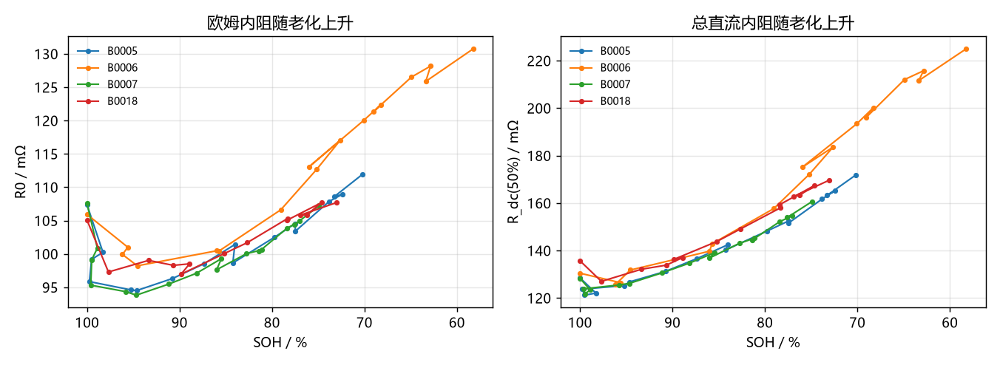
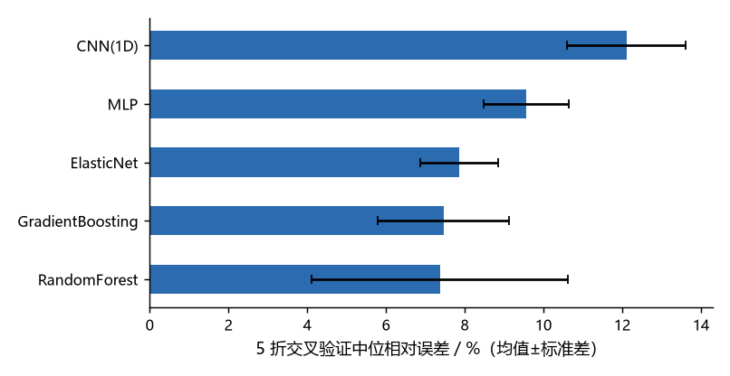
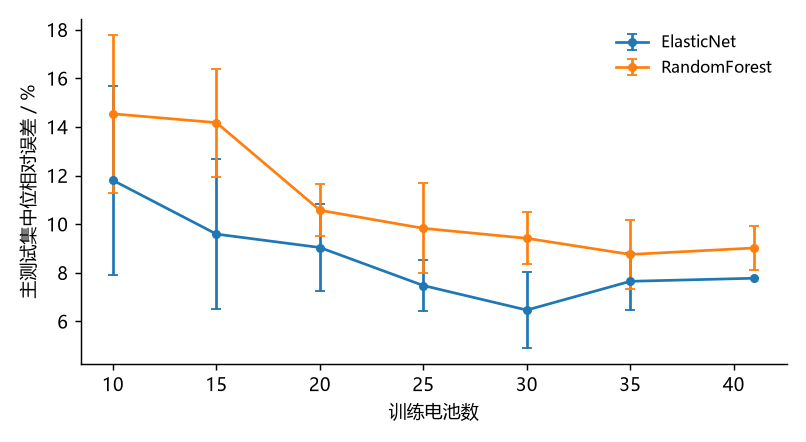
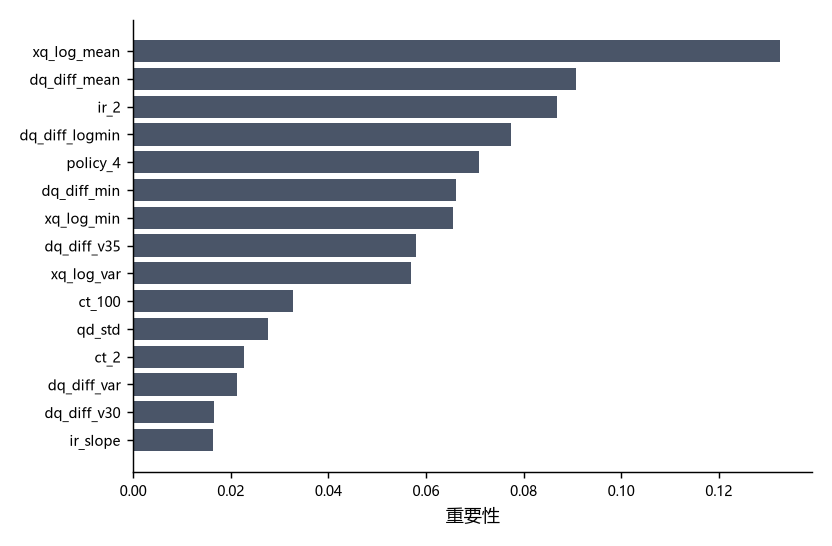

# 结果

所有数字均由 `scripts/phase_a2_ecm.py` 与 `scripts/phase_c_rul.py` 在固定种子 42 下产生，
原始表格见 [`reports/`](../reports/)。

---

## 一、ECM 参数辨识

### 1.1 辨识参数

| 电池 | I_dc (A) | R0 (mΩ) | R_dc(50%) (mΩ) | R_pol(50%) (mΩ) | R_dc(80%) (mΩ) | R_dc(20%) (mΩ) |
|---|---|---|---|---|---|---|
| B0005 | 2.012 | 107.35 | 128.50 | 21.15 | 122.75 | 128.34 |
| B0006 | 2.011 | 105.92 | 130.45 | 24.54 | 118.82 | 124.84 |
| B0007 | 1.990 | 107.58 | 128.26 | 20.68 | 119.73 | 129.38 |
| B0018 | 2.009 | 105.05 | 135.68 | 30.63 | 122.47 | 132.63 |

**物理一致性**：R0 集中在 105–108 mΩ；总内阻随 SOC 降低而上升（R_dc(80%) < R_dc(50%) < R_dc(20%)），
对应低 SOC 下电荷转移阻抗增大——与电化学直觉一致。

### 1.2 同工况复测精度

| 电池 | 训练圈 RMSE | **复测 RMSE** | 判定（≤ 量程 2%） |
|---|---|---|---|
| B0005 | 1.37% | 1.72% | ✅ |
| B0006 | 0.39% | **0.96%** | ✅ |
| B0007 | 2.78% | 3.29% | ❌ |
| B0018 | 0.99% | 1.49% | ✅ |

中位 **1.61%**，4 颗中 3 颗达标。


### 1.3 内阻随老化

| 电池 | SOH 区间 | R0 变化 | R_dc(50%) 变化 |
|---|---|---|---|
| B0005 | 100% → 70% | +4.3% | +33.7% |
| B0006 | 100% → 58% | +23.6% | +72.4% |
| B0007 | 100% → 75% | −0.4% | +25.3% |
| B0018 | 100% → 73% | +2.6% | +25.0% |

4 颗共同覆盖区间（SOH 100% → 70%）的均值：**R0 +5%，R_dc +33%**。

> 结论：内阻增长几乎全部来自极化项。欧姆内阻到寿命末期才明显抬头（B0006 在 SOH 58% 时 +24%）。



### 1.4 B0007 为什么超标

前 20 圈存在明显的容量再生（QDischarge 先降后升），充放电平均法得到的 OCV 被污染，
导致复测时电压偏差集中在低 SOC 段。这是数据特性，不是实现 bug——同样的代码在其余 3 颗上都在 1.8% 以内。

---

## 二、RUL 寿命预测

### 2.1 主协议（训练 41 颗，官方划分）

使用全部 60 维特征：

| 模型 | 主测试 43 颗<br>中位 APE | 平均 APE | RMSE (圈) | R² | 最大 APE | 二级测试 40 颗<br>中位 APE |
|---|---|---|---|---|---|---|
| **GradientBoosting** | **6.20%** | 12.87% | **105.1** | **0.93** | 220.6% | 16.37% |
| ElasticNet | 7.77% | 21.27% | 369.7 | 0.11 | 334.2% | 28.64% |
| MLP | 7.69% | 26.01% | 378.7 | 0.06 | 467.2% | 24.71% |
| RandomForest | 8.12% | 16.22% | 158.9 | 0.84 | 263.4% | **11.89%** |
| 1D CNN | 32.67% | 38.95% | 527.4 | −0.82 | 334.2% | 57.09% |
| 常数中位数（基线） | 17.14% | 29.54% | 431.6 | −0.22 | 256.1% | 45.33% |


**解读**

- **GBM 主测试 6.20%、R²=0.93**，比基线（17.14%）好近 3 倍，RMSE 105 圈。
- **但跨批次掉到 16.37%，R² 归零**。全部特征里有相当一部分编码的是充电协议，batch3 换了策略就失效——下一节专门拆这件事。
- **RandomForest 跨批次最稳（11.89%）**：叶子均值天然有界，不会像线性模型那样外推失控。
- **ElasticNet 的 R² 只有 0.11**：中位数 7.77% 好看，是因为一半样本贴着对角线，另一半偏差极大。这种「中位数好看、方差巨大」的模型不适合交付。
- **1D CNN 32.67%**：预测值明显向均值收缩。

### 2.2 特征口径消融：6 维 vs 60 维

两套特征口径：`paper6` 为论文 Table 1 口径——ΔQ(V)=Q₁₀₀−Q₁₀ 的 3 个 log 统计量加容量序列 3 个趋势量，共 6 维；`full` 在其上加入滞回特征（Qd−Qc）、定点值与老化标量，共 60 维。三个形状特征与 log₁₀(寿命) 的相关系数全在 0.91 以上（`xq_log_var` −0.927、`xq_log_min` −0.922、`xq_log_mean` −0.911），趋势特征不到 0.4——「形状 >> 容量」在相关系数层面就成立。

同一划分、同一模型，只换特征集：

| 模型 | 主测试（60 维） | 主测试（6 维） | batch3（60 维） | batch3（6 维） |
|---|---|---|---|---|
| ElasticNet | 7.77% | 8.33% | 28.64% | **6.31%** |
| GradientBoosting | **6.20%** | 8.58% | 16.37% | **8.03%** |
| RandomForest | 8.12% | 9.38% | 11.89% | **8.22%** |


**三条结论**：

1. **同分布下多特征有收益**：GBM 6.20% < 8.58%，滞回特征确实补充了信息。
2. **跨批次下多特征是负担**：6 维的三个模型全部落在 6.3–8.2%，60 维则从 11.9% 散到 28.6%。弹性网差距最大，**4.5 倍**。
3. **6 维跨批次几乎不退化**：GBM 8.58% → 8.03%，反而略好。说明论文那三个 ΔQ 形状特征抓住的是**电池本征状态**，而不是测试环境。

作为外部参照，同一数据集、同样论文 6 特征的另一份独立复现（[battery-lifetime-guide](https://github.com/ilo-love7/battery-lifetime-guide)）报 EN 5.9% / batch3 4.9%。本项目 8.33% / 6.31%，同量级、同趋势（跨批次不退化）。

**这个差距的来源已经定位，不在数据口径。** 逐颗对齐两份复现的预测表后发现：随机森林在主测试上**完全一致**（本项目 8.12%，对方 8.2%）。RF 不调超参就能对齐，说明 124 颗筛选、官方划分、寿命标签、ΔQ 特征四条链都是对的。差距只出现在 ElasticNet 上，原因是超参搜索空间不同——本项目早期版本 `tune_elasticnet()` 只搜 alpha、**l1_ratio 固定 0.5**；对方用 `ElasticNetCV(l1_ratio=[0.1, 0.5, 0.9, 1.0])`，即把 l1_ratio 也交给 CV。论文六特征是稀疏信号，l1_ratio → 1（纯 Lasso）才做得了特征选择，固定 0.5 的弹性折中天然吃亏。

代码已改为同时搜 alpha 与 l1_ratio（见 `scripts/phase_c_rul.py` 的 `tune_elasticnet()`），但**本节表格中的 8.33% / 6.31% 仍是 l1_ratio=0.5 时代的旧结果，尚未重跑验证**。重跑需要 MIT-Stanford 原始数据（`data/raw/mit/`，8.3 GB）：

```bash
python scripts/phase_c_rul.py     # 会打印 paper6 选中的 alpha 与 l1_ratio
python -c "import pandas as pd; print(pd.read_csv('reports/phaseC_ablation.csv'))"
```

预期 EN 六特征会向 5.9% 靠拢；若靠拢不了，则差异另有来源，应回来修订本节。两仓的分工与完整口径对照见 [`sibling_projects.md`](sibling_projects.md)。

### 2.3 补充协议：全量 124 颗 5 折交叉验证

| 模型 | 中位 APE（均值 ± 标准差） |
|---|---|
| RandomForest | **7.37% ± 3.25** |
| GradientBoosting | 7.46% ± 1.66 |
| ElasticNet | 7.86% ± 0.99 |
| MLP | 9.56% ± 1.08 |
| 1D CNN | 12.11% ± 1.50 |



**同一张 CNN 网络，41 颗训练电池时 32.7%，99 颗时 12.1%。** 这是全项目最有信息量的一组对照：
在电池数据上堆深度模型之前，先问「有多少颗电池」，而不是「有多少个循环点」。

### 2.4 数据效率：学习曲线

训练电池数从 10 增到 41：

| 训练电池数 | ElasticNet 中位 APE | RandomForest 中位 APE |
|---|---|---|
| 10 | 11.8% | 14.5% |
| 15 | 9.6% | 14.2% |
| 20 | 9.0% | 10.6% |
| 25 | 7.5% | 9.8% |
| 30 | 6.5% | 9.4% |
| 35 | 7.6% | 8.8% |
| 41 | 7.8% | 9.0% |



30 颗之后基本走平，尾部还有轻微回升——41 颗已经接近这批数据的收益边界。

### 2.5 特征重要性

随机森林重要性前五位：

| 排名 | 特征 | 含义 |
|---|---|---|
| 1 | `xq_log_mean` | 论文 ΔQ(V) 均值——曲线整体下移幅度 |
| 2 | `dq_diff_mean` | 滞回差值曲线均值 |
| 3 | `ir_2` | 第 2 圈内阻 |
| 4 | `dq_diff_logmin` | 滞回差值曲线的对数最小值 |
| 5 | `policy_4` | 充电策略参数 |

前 10 里有 3 个是论文口径的 `xq_*`（第 1、7、9 位），说明那三个形状特征即使混在 60 维里也压得住场；
`ir_2` 与 `policy_4` 说明**初始内阻**和**充电协议**本身就是寿命的强预测因子——后者正是跨批次失效的来源。



---

## 三、物理仿真（PyBaMM）

完整推导与图表见 [sim.md](sim.md)，这里只列数字。

### 3.1 模型谱系（1C 放电，相对 DFN 的电压误差）

| 模型 | RMSE | 最大偏差 | 单次耗时 |
|---|---|---|---|
| DFN（参照） | 0 mV | 0 mV | 0.42 s |
| SPM | **5.16 mV** | 5.38 mV | 0.17 s |
| Thevenin（阶段 A 参数） | 200.95 mV | 226.84 mV | 0.02 s |
| Thevenin（反演 SPM 参数） | **17.19 mV** | 45.24 mV | 0.02 s |

同一套结构、换一组参数，误差差一个数量级。**等效电路模型的精度瓶颈通常不是「一阶 RC 太简单」，而是「参数不是这块电池的」。**

### 3.2 倍率能力

| 倍率 | 可用容量 / Ah | 能量 / Wh | 容量利用率 |
|---|---|---|---|
| 0.5C | 2.119 | 6.665 | 100.0% |
| 1C | 1.940 | 6.028 | 91.5% |
| 2C | 1.600 | 4.894 | 75.5% |
| 3C | 1.329 | 4.026 | 62.7% |
| 4C | 1.129 | 3.399 | 53.3% |

### 3.3 七条快充协议

| 协议 | t80 / min | 总时长 / min | 温升 / K |
|---|---|---|---|
| 1C 恒流（基线） | 45.2 | 85.4 | 8.4 |
| 3C 恒流 | 19.5 | 60.1 | 23.6 |
| 3.6C(80%)-3.6C(10%)-3.6C(10%) | 17.8 | 58.5 | 26.4 |
| 4.8C(80%)-3.6C(10%)-3.2C(10%) | **16.2** | 56.8 | **29.9** |
| 6C(60%)-3C(40%) | 16.2 | **56.7** | 28.9 |
| 3C(20%)-1C(80%) | 37.9 | 78.1 | 16.3 |
| 1C(80%)-3C(20%) | 45.0 | 85.2 | 8.4 |

**t80 能压 2.8 倍（45.2 → 16.2 min），总时长只能压 1.5 倍（85.4 → 56.8 min）**——
差的这一块全在恒压段。所以「插枪到拔枪」不是衡量快充的好指标。

`1C(80%)-3C(20%)` 与 `1C 恒流` 的每一项都相同：高 SOC 段的 3C 一上来就贴着 4.2 V，
这段恒流**一步也没走成**，协议退化为 1C 恒流。

### 3.4 ΔQ(V) 的机制归因

注入已知衰减模式后测 ΔQ(V) 响应（完整数据表见 `docs/sim.md`）：锂库存损失 LLI 的 ΔQ 深度 235.2 mAh、与实测形态相关 **+0.64**；负极活性材料损失 LAM_neg 为 229.4 mAh、**+0.58**；正极活性材料损失 LAM_pos 只有 9.5 mAh、−0.07。MIT 实测中位 ΔQ 深度 38.8 mAh 落在仿真 3%–6% 退化对应区间，量级自洽。**ΔQ(V) 主要测 LLI 与 LAM_neg，对 LAM_pos 几乎不敏感。**

### 3.5 协议 vs 寿命（30 圈）

析锂把容量损失的绝对水平放大了 10 倍（纯 SEI 3.48%–3.77% vs SEI+析锂 34.88%–36.62%，离散度均 ≤0.08），但**没有放大协议之间的差异**：7 条协议的 t80 相差 2.8 倍，容量损失只差 1.7 个百分点，比实测的离散度 2.61 小两个数量级（完整数据见 `docs/sim.md`）。

原因是所有协议都要把同样的电量充进去（都充到 4.2 V 再恒压到 C/20），电压上限又把激进协议的恒流段截断，实际轨迹趋同。**「协议 → 寿命」这条链条在本仿真里没有复现出来**，如实记录；这与 MIT 数据里 `chargetime` 与寿命相关只有 −0.05 是同一件事的两面。

### 3.6 仿真增强：负结果

| 实验臂 | EN 主测试 | EN 二级 | GBM 主测试 | GBM 二级 |
|---|---|---|---|---|
| P1 基线（6 维） | 8.33% | 6.31% | 8.58% | 8.03% |
| P1 + 模式系数（9 维） | 8.41% | 6.69% | 9.63% | 8.31% |
| 仅模式系数（3 维） | 23.02% | 43.13% | 19.81% | 34.43% |

四组全部持平或变差，未达「提升 ≥5%」的预设标准。原因：模式系数在 124 颗电池间几乎无差异（LLI 占比标准差 0.018）、仿真基与实测形态相关仅 0.64、原始 ΔQ 统计量已是最优压缩。

> **仿真解释了 ΔQ(V) 为什么有效，但替代不了它。**

---

## 四、P3 审计与三线合并（阶段 E / F）

完整推导见 `docs/audit.md`，这里只列可核对的数字。

### 4.1 判据自证：参数翻倍，残差不变

P3 的 OCV 是从参数反推的，再用同一组参数仿真回去，残差只剩离散化误差：原参数 0.12–0.16 mV，参数 ×2 或 ×0.5 后仍 ≤0.31 mV，而换另一颗电池的模型残差跳到 8.7–12.0 mV。**判据「≤2% 量程」对参数没有约束力。**

### 4.2 参数由先验决定

`r_dc_mid = (OCV50_prior − V(SOC=0.5)) / I`。先验从 3.76 V 扫到 3.96 V，三颗电池的 r_dc 全部从约 116 mΩ 跳到约 215 mΩ（±50 mΩ）；P3 自述精度 ±25 mΩ，低估约 4 倍。三颗电池在任何先验下曲线重合，所以「三颗电池 r_dc 一致」不是辨识结论。

### 4.3 τ2 是窗口的函数

全窗口下 B0006 的 τ2 为 95.0 s，比它自己的观测窗口（77.7 s）还长——**不可辨识**；把窗口截断到 45%，B0005 的 τ2 从 162.4 s 掉到 94.3 s。τ2 的数值主要由窗口长度决定。

### 4.4 采样率决定 R0（P3 → P2 的桥）

把 P3 流程套到 DFN 合成曲线上只改采样间隔，真值恒为 38.6 mΩ：dt=0.05 s 时还原出 38.6 mΩ，dt=18.7 s（NASA 实际采样）时报出 208.1 mΩ。P3 的 `step_drop`（105.9–107.5 mΩ）与 dt=18.7 s 合成曲线的 105.0 mΩ 几乎逐位重合——**它测到的「阶跃内阻」里 63% 是采样伪影。**

### 4.5 内阻 vs ΔQ(V)：P1 为什么选后者（P2 → P1 的桥）

从 3% 退化到 10%，R0 在三种模式下变化都在 ±7% 内且方向不一致（LLI −7.1%、LAM_pos +0.8%、LAM_neg +6.2%），而 ΔQ 深度跨模式差 25 倍。**这就是 P1 全部特征建在 ΔQ(V) 上、而不建在内阻上的物理原因。**

---

## 五、结论

1. **口径决定上限**。124 颗的筛选顺序、化成圈处理、寿命标签搜索起点，任何一处偏差都会让后续指标失真。
2. **特征口径决定跨批次泛化**。60 维里混进了编码充电协议的滞回特征：同分布 6.20% 很好看，跨批次 16.37% 就露馅；换成论文 6 维，8.58% → 8.03% 几乎不退化。
3. **小样本下树模型最稳**。GBM 主测试 6.20%（R²=0.93），RF 跨批次 11.89%，两者各守一头。
4. **深度模型要的是电池数**。同一条 CNN，41 颗 32.7%、99 颗 12.1%。
5. **ECM 的价值在解释，不在预测**。它给不出 6% 的精度，但能说清「内阻涨的是极化项，不是欧姆项」，
   这条结论可以直接指导 BMS 的健康指标设计。
6. **仿真能归因，不能增强**。PyBaMM 把 ΔQ(V) 归因到 LLI 与 LAM_neg（r=0.64 / 0.58），
   但把模式系数当特征加进 RUL 模型全部无效——机制解释与统计预测是两件事。
7. **协议层的时间与温升指标不足以区分寿命**。7 条协议的 t80 相差 2.8 倍，30 圈容量损失只差
   1.7 个百分点（离散度 0.05，实测 2.61）。「协议 → 寿命」这条链条在本仿真里没复现出来。
8. **能被测量 ≠ 能被辨识**。同一批电压曲线，ΔQ(V) 能把寿命预测到 6.2% 误差；
   而 P3 那条「先验锚定 + 自证判据 + 粗采样」的链条，同一个内阻可以报出 65–208 mΩ 之间的任何值。

---

## 六、复现核对

跑完脚本后，用以下命令确认结果与本文一致（数值应完全一致，随机种子固定）：

```bash
# ECM
python -c "import pandas as pd; print(pd.read_csv('reports/phaseA2_ecm_results.csv')[['cell','rmse_test_raw_pct']])"

# RUL 主协议
python -c "import pandas as pd; d=pd.read_csv('reports/phaseC_metrics.csv'); print(d.pivot(index='model', columns='eval_set', values='median_ape').round(2))"

# 特征口径消融
python -c "import pandas as pd; d=pd.read_csv('reports/phaseC_ablation.csv'); print(d.pivot_table(index=['feature_set','model'], columns='eval_set', values='median_ape').round(2))"

# 5 折 CV
python -c "import pandas as pd; d=pd.read_csv('reports/phaseC_cv.csv'); print(d.groupby('model')['median_ape'].agg(['mean','std']).round(2))"

# 物理仿真
python -c "import pandas as pd; print(pd.read_csv('reports/phaseD1_sim.csv')[['model','rmse_vs_dfn_mV']])"
python -c "import pandas as pd; print(pd.read_csv('reports/phaseD2_augment.csv')[['arm','model','eval_set','median_ape']])"

# P3 审计与桥接
python -c "import pandas as pd; print(pd.read_csv('reports/phaseE_p3_selfconsistency.csv')[['bat','param_set','rmse_mV']])"
python -c "import pandas as pd; print(pd.read_csv('reports/phaseF_bridge.csv')[['dt_s','R0','rdc','step']])"
```

| 指标 | 期望值 |
|---|---|
| B0005 / B0006 / B0007 / B0018 复测 RMSE | 1.72 / 0.96 / 3.29 / 1.49 % |
| GBM 主测试中位 APE（60 维） | 6.20% |
| GBM 二级测试中位 APE（60 维） | 16.37% |
| GBM 主测试 / batch3（论文 6 维） | 8.58% / 8.03% |
| ElasticNet batch3（论文 6 维） | 6.31% |
| RF 5 折 CV 中位 APE | 7.37% |
| SPM / Thevenin(反演) 相对 DFN 的 RMSE | 5.16 / 17.19 mV |
| LLI / LAM_pos / LAM_neg 与实测形态相关 | +0.64 / −0.07 / +0.58 |
| 仿真增强（EN 主测试，6→9 维） | 8.33% → 8.41%（变差） |
| 快充 t80（1C / 4.8C 多步） | 45.2 / 16.2 min |
| 协议容量损失离散度（纯 SEI / 加析锂） | 0.08 / 0.05 |
| P3 自洽残差（原参数 / ×2 / 换电池） | 0.12–0.16 / 0.24–0.31 / 8.7–12.0 mV |
| 合成曲线 R0（dt=0.05 s / 18.7 s） | 38.6 / 208.1 mΩ |

> 深度模型（1D CNN）在 CPU 上有轻微浮点差异，中位 APE 可能在 ±0.3 个百分点内波动，属正常。
